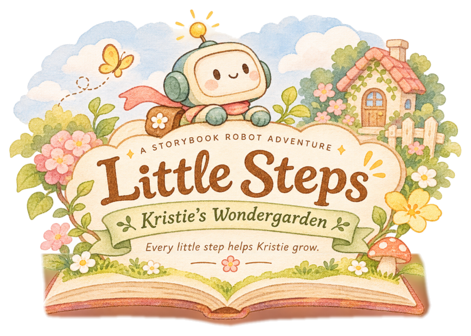
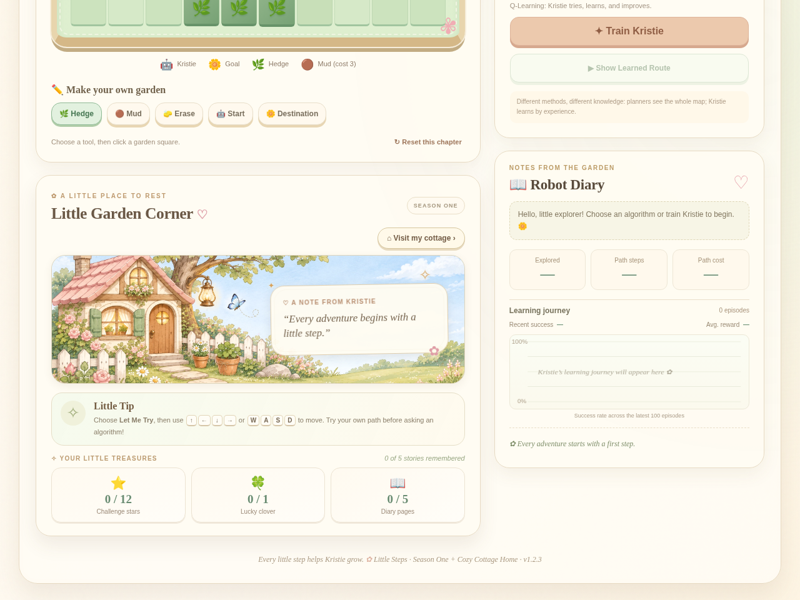
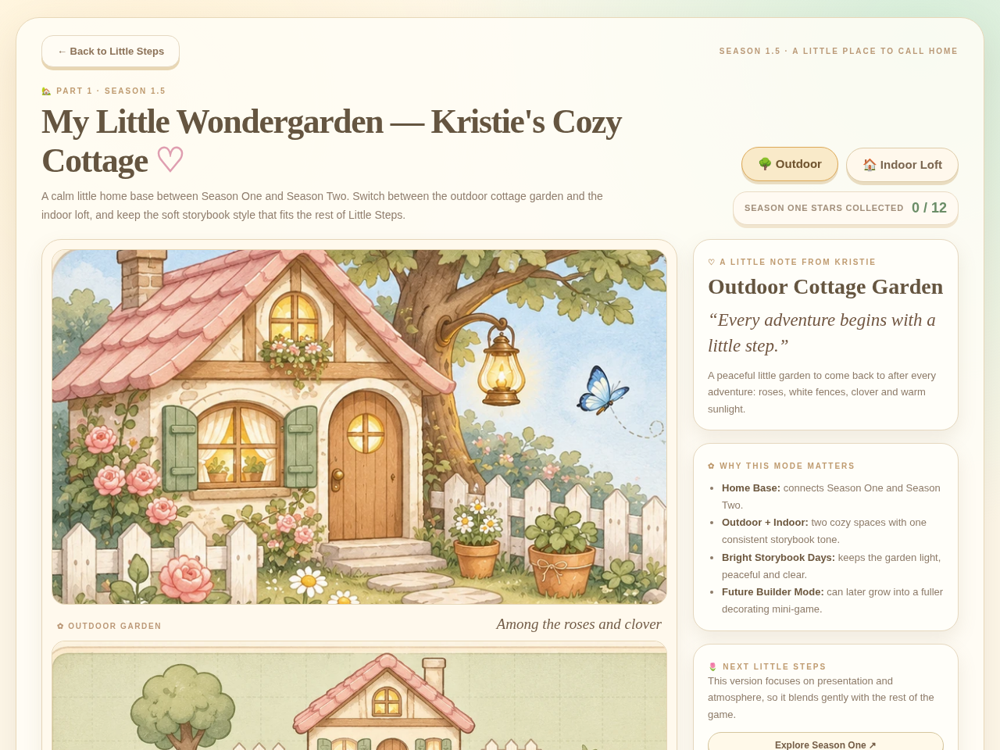

<p align="center">
  
</p>

<h1 align="center">Little Steps · Kristie's Wondergarden 🌷</h1>

<p align="center"><strong>Every little step helps Kristie grow.</strong></p>

<p align="center">
  A little robot. Five storybook adventures. One garden full of lessons about finding your own way.
</p>

<p align="center">
  <a href="https://yunmo0121.github.io/Little-Steps/"><strong>🎮 Play the game</strong></a>
  &nbsp;·&nbsp;
  <a href="开始使用_中文.md">📖 中文使用说明</a>
  &nbsp;·&nbsp;
  <a href="#-how-to-play">How to play</a>
</p>

---

## ✨ Once upon a little garden...

Meet **Kristie**, a tiny cream-and-teal robot with a pink scarf and a flower satchel. She is learning to explore, make choices, help friends and discover that every mistake can be the beginning of something new.

*Little Steps* is a browser-based storybook game that combines **interactive pathfinding**, **tabular reinforcement learning**, and a gentle five-chapter growth story. You can guide Kristie yourself, watch an algorithm plan a route, or let her learn through practice.

The game includes a quiet stop between adventures: **My Little Wondergarden — Kristie's Cozy Cottage**, with an outdoor garden and an indoor loft. The cottage is currently a **storybook home preview**, not yet a free-placement decorating editor.

## 🌼 A peek inside

<p align="center">
  
  
</p>

*Illustrated scenery, real gameplay controls and a diary that remembers Kristie's progress.*

## 📖 Season One · The Wondergarden Adventures

| Chapter | Little adventure | What Kristie learns |
| :-- | :-- | :-- |
| **01 · The First Flower 🌼** | Find a glowing flower and learn your first route. | **Courage** — take the first step. |
| **02 · Muddy Meadow 🌦️** | Explore puddles and a bridge; compare short routes with low-cost routes. | **Wisdom** — the shortest route isn't always the best. |
| **03 · Mushroom Village 🍄** | Find a lost rabbit before bringing her back to the cottage. | **Kindness** — sometimes the journey is for someone else. |
| **04 · Whispering Woods 🌲** | Adapt when the wind changes the obstacles and the route. | **Adaptability** — a changed plan isn't a failed plan. |
| **05 · Starlight Garden 🌙** | Collect two starlight fragments before reaching the final star. | **Confidence** — you've come further than you think. |

The five chapters have replayable opening stories, themed objectives and a closing scene. The first completion of each chapter awards **50 XP** (up to **250 XP** for Season One); Chapters 2–5 also have replayable three-star challenges. There is no combat or failure penalty for exploring.

> “The world is bigger than I ever imagined.”
>
> — Kristie, at the end of Season One

## 🎮 How to play

1. Open the **[playable website](https://yunmo0121.github.io/Little-Steps/)** or download this repository and open `index.html` locally. The site is a static HTML/CSS/JavaScript project — no installation or account required.
2. Choose **Start Adventure** to begin from Chapter 1. **If you already have progress, choose Continue instead:** Start Adventure begins a new journey and resets the saved chapter progress in that browser.
3. Read (or skip) the illustrated opening story, then follow **How to Play** if you'd like an optional guided introduction to BFS and Q-Learning.
4. Choose **Let Me Try** to move Kristie with **WASD**, **arrow keys**, or the on-screen directional pad. Explore the garden and discover the goal.
5. Try **BFS**, **Dijkstra** or **A\*** to see another way through the map. Use **Train Kristie** to run a tabular Q-Learning experiment, then **Show Learned Route** once a route is available.
6. Visit **Chapters** for unlocked stories, **Robot Diary** for progress and training notes, or **My Little Home** to see the outdoor cottage and indoor loft.

Need a hand? See the [Chinese player's guide](开始使用_中文.md) for controls, stars, saves and troubleshooting.

## 🧠 The algorithms behind the adventure

| Algorithm | How it works in the game | Important distinction |
| :-- | :-- | :-- |
| **BFS** | Explores the grid by number of moves. | Finds a path with the fewest steps on an unweighted grid; it ignores mud costs. |
| **Dijkstra** | Uses movement cost to select a lowest-cost route. | Grass costs **1**, mud costs **3**. |
| **A\*** | Uses weighted path cost and a Manhattan-distance heuristic. | Also seeks a lowest-cost route, with heuristic guidance. |
| **Tabular Q-Learning** | Learns action values from simulated episodes, epsilon-greedy exploration and rewards. | Learns a policy through experience; unlike the planners, success depends on training. |

**An example from Chapter 2's default map:** BFS finds a **14-step route costing 26**, while Dijkstra and A\* can choose **16-step routes costing 16**. The shortest route in steps is not necessarily the cheapest one.

This is an educational interactive prototype, not a claim that reinforcement learning outperforms classical graph search. The algorithms have different information and training assumptions.

## 🏡 Season 1.5 · Kristie's Cozy Cottage

Between the first garden and the next big adventure is a small place Kristie can call home.

- **Outdoor:** rosy cottage roof, white picket fence, potted clover, flowers and a peaceful garden.
- **Indoor Loft:** a warm duplex-style attic with a tiny upstairs bed, staircase, reading corner and tea table.
- **Home progress:** displays the number of Season One challenge stars collected (**out of 12**).
- **Daytime-only design:** a soft, clear storybook palette matching the rest of the game.

The outdoor/indoor view choice is remembered locally. **Moving furniture, purchasing decorations, and freely editing the cottage are planned features, not available in v1.2.3.** The terrain editor in adventure chapters is a separate tool for experimenting with maps.

## 💾 Saving progress

Progress is saved in your browser's `localStorage`. This includes chapter completion, XP, challenge stars and selected chapter information; the cottage remembers the most recently selected view. The game has **no cloud save or account sync**.

- **Continue** restores a saved journey where possible.
- **Start Adventure** starts from Chapter 1 and **resets adventure progress without a separate confirmation**.
- **Settings → Reset save** asks for confirmation before erasing saved adventure data.
- Different browsers, devices and origins (such as `file://` and GitHub Pages) do **not** automatically share save data.

If local-file storage behaves inconsistently, run a local static server from the project folder:

```bash
python3 -m http.server 8000
```

Then open `http://localhost:8000/`. No backend or external dependencies are used by the game.

## 🛠️ Tech stack & project structure

- **HTML, CSS, vanilla JavaScript** — interface, stories, character animation and route visualization.
- **Graph search & tabular Q-Learning** — implemented directly in JavaScript.
- **Browser localStorage** — local save state.
- **Node.js (optional)** — dependency-free test scripts.

```text
Little-Steps/
├── index.html                 # Game entry point
├── app.js                     # Five chapters, pathfinding, RL and saves
├── styles.css                 # Main game and storybook UI
├── home.js                    # Cottage view switching and star display
├── home.css                   # Cottage and garden corner styling
├── assets/                    # Artwork and favicon
├── docs/
│   ├── screenshots/           # Actual gameplay previews
│   ├── GAME_DESIGN.md
│   └── FUTURE_ROADMAP.md
├── tests/                     # Automated tests (Node.js)
├── 开始使用_中文.md              # Chinese player's guide
├── CHANGELOG.md
└── PUBLISH_GUIDE_CN.md         # Maintainer's GitHub publishing guide
```

Run the tests (requires Node.js, **no npm install**):

```bash
node tests/test_algorithms.cjs
node tests/test_corner.cjs
node tests/test_homebase.cjs
```

## 🌊 Beyond the Garden · What's next?

The next dream is **The Enchanted Isles** — a magical archipelago with a **World Map**, a little boat, tides, lighthouses, cloud bridges and new friends. We also hope to develop the Cozy Cottage into a genuine decorating game, so Kristie can bring little souvenirs home after her adventures.

**Season Two and the World Map are concepts, not yet playable.** Read [Future Roadmap](docs/FUTURE_ROADMAP.md) for the design direction.

## ♡ Credits & notes

Created as a personal creative-coding and learning project by **[@Yunmo0121](https://github.com/Yunmo0121)**, with AI-assisted coding and illustration development. The project's storybook visual assets are generated and curated for this game; the algorithm implementations and interactive UI are included in this repository for inspection.

*Little Steps is a learning project, lovingly made one little step at a time.* 🌷
