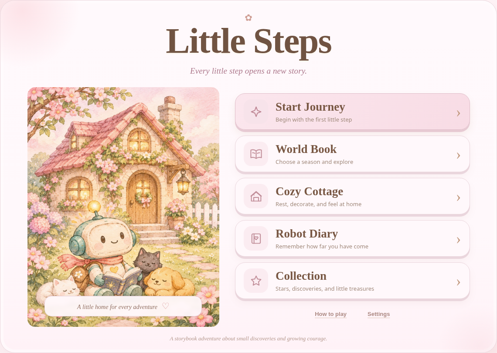
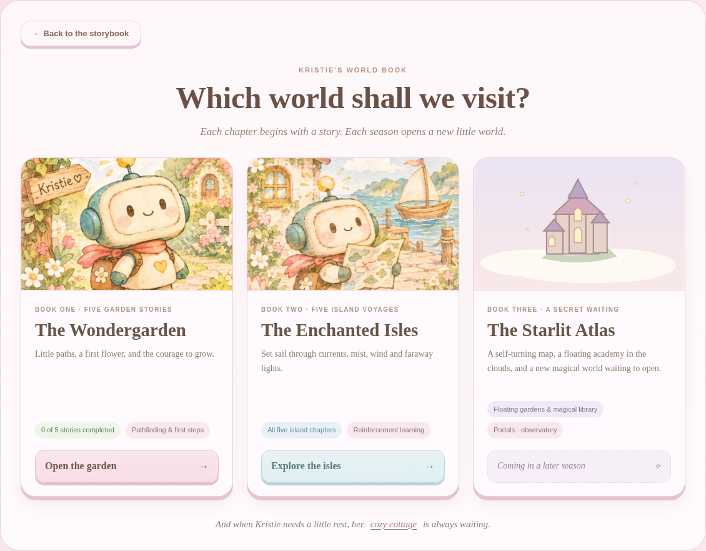
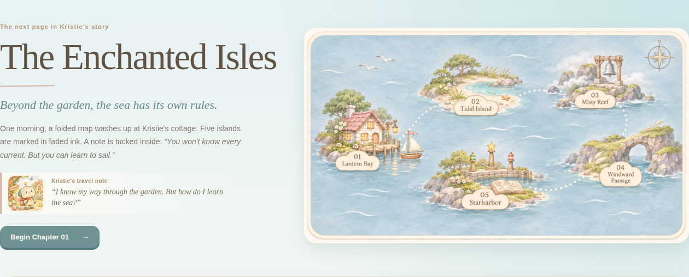
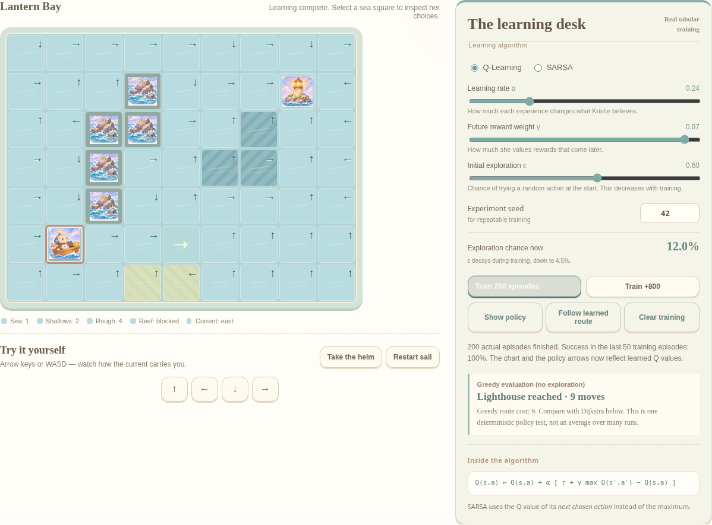
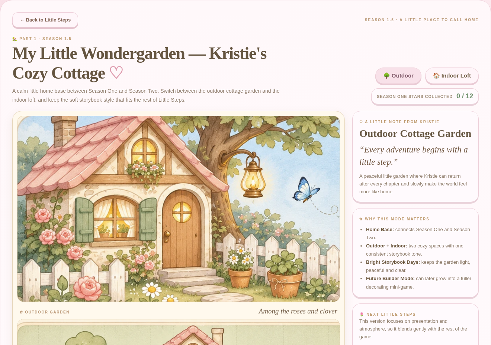
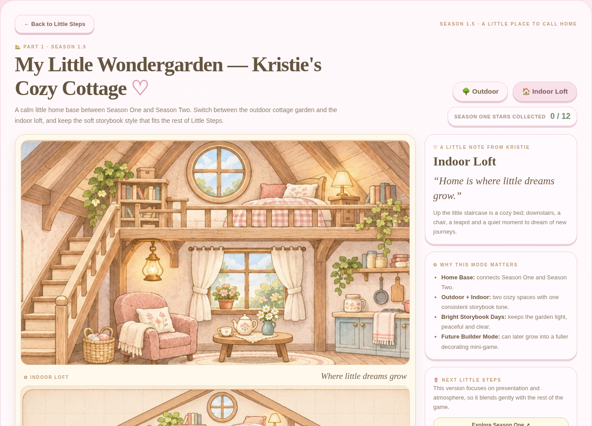

<h1 align="center">Little Steps</h1>
<p align="center"><em>Every little step opens a new story.</em></p>
<p align="center">A storybook adventure about a little robot, finding your way, and learning from experience.</p>

<p align="center">
  <a href="https://yunmo0121.github.io/Little-Steps/"><strong>Play in your browser</strong></a>
  · <a href="开始使用_中文.md">中文游玩指南</a>
  · <a href="#getting-started">Getting started</a>
  · <a href="#reinforcement-learning-lab">RL experiments</a>
</p>

<p align="center">
  
</p>

## Welcome to Little Steps

Meet **Kristie**, a small cream-and-teal robot with a pink scarf, a flower satchel and a growing curiosity about the world. In this interactive storybook game, you can explore with her, choose your own route, compare pathfinding algorithms, and train a reinforcement-learning agent to navigate unfamiliar environments.

**Version 2.0.0 completes two playable seasons (ten chapters)** and includes a quiet home between them: **Kristie's Cozy Cottage**. The focus is not on flashy simulations, but on connecting the *reasoning* behind an algorithm to something you can actually try.

This is a personal creative-coding and learning project, built with HTML, CSS and vanilla JavaScript. It runs entirely in the browser; no sign-in, backend or package installation is required to play.

## Explore the worlds

| World | Chapters | What you'll discover | Status |
| :-- | :--: | :-- | :-- |
| **Season One — The Wondergarden** | 5 | Garden stories, pathfinding, and an introduction to learning by trial and error | Playable |
| **Season 1.5 — Cozy Cottage** | — | An outdoor garden and a warm indoor loft, with locally saved view preferences | Available home preview |
| **Season Two — The Enchanted Isles** | 5 | Sailing, tides, fog, uncertain winds and multi-goal reinforcement learning | **Complete & playable in v2.0.0** |
| **Season Three — The Starlit Atlas** | — | A floating magical academy, mysterious maps and possible new learning challenges | Concept only |

<p align="center">
  
</p>

### Season One · The Wondergarden

Five gentle adventures introduce Kristie to making decisions and finding a route.

| Chapter | Story | Learning theme |
| :-- | :-- | :-- |
| 01 — The First Flower | Find the first glowing flower | Courage; introductory routes |
| 02 — Muddy Meadow | Compare short and low-cost paths | Wisdom; BFS vs Dijkstra/A* |
| 03 — Mushroom Village | Help a lost rabbit find her home | Kindness; multi-stage objectives |
| 04 — Whispering Woods | Replan when the path changes | Adaptability |
| 05 — Starlight Garden | Collect starlight and finish the journey | Confidence |

The season includes illustrated opening stories, manual movement, map-editing tools, BFS, Dijkstra, A*, and tabular Q-Learning. First-time chapter completion awards XP; later chapters offer replayable star challenges.

### Season Two · The Enchanted Isles

The updated illustrated map connects **five playable island chapters**. Each has a three-page illustrated story and a learning environment with its own question to investigate.

<p align="center">
  
</p>
<p align="center"><sub>Season Two world map — five illustrated islands.</sub></p>

| Chapter | Adventure | Core RL concept |
| :-- | :-- | :-- |
| **01 — Lantern Bay** | Sail past reefs and an eastward current to reach a lighthouse | Finite MDPs, Q-Learning vs SARSA, rewards and exploration |
| **02 — Tidal Island** | Cross a sandbar that changes with the tide; sometimes wait | State representation `(position, tide phase)` and a **WAIT** action |
| **03 — Misty Reef** | Explore fogbound coral reefs and find the ancient silver sea bell | **Exploration vs exploitation**, map discovery and ε comparisons |
| **04 — Windward Passage** | Navigate a channel where gusts can redirect your boat | **Stochastic transitions** and multi-seed policy evaluation |
| **05 — Starharbor** | Visit three beacons and return to the harbour | **Multi-goal state**, rewards and generalisation probes |

The wooden sailing boat, Kristie's robot design and her three companions — a white cat, a grey cat and a golden puppy — carry the story from one island to the next.

The final chapter plants a clue for a future season: a self-turning atlas that reveals a magical academy high above the clouds. **Season Three is not implemented or playable yet.**

## Getting started

**Play online:** [yunmo0121.github.io/Little-Steps](https://yunmo0121.github.io/Little-Steps/) (the live site updates after this release is pushed to GitHub Pages).

**Run locally:** Download the complete repository, keep the directory structure intact, and open `index.html`. If browser storage or local-file restrictions cause problems, serve the folder locally:

```bash
cd Little-Steps
python3 -m http.server 8000
```

Open `http://localhost:8000/` in your browser. You don't need Python if you simply open the HTML file and your browser allows it.

**Navigate:**

1. **Start / Continue Journey** returns to the garden story. Existing progress is saved in your browser.
2. **World Book** lets you enter Season One or Season Two. Season Three is a preview, not a working button.
3. **Cozy Cottage** opens the outdoor garden and indoor loft.
4. **Robot Diary** and **Collection** show stored memories, XP, story pages and treasures.
5. **How to play** explains the controls; **Settings** contains save-related options.

**Controls:** Use **WASD** or **arrow keys**, or the on-screen direction buttons. On **Tidal Island**, **Space** or **Wait** advances the tide without moving. Choose **Take the helm / Let Me Try** where shown to enable manual movement. Story pages can be read or skipped.

> **Save note:** Progress and training tables are stored in your browser's `localStorage`; there is no account or cloud sync. Different devices, browsers, or `file://` versus GitHub Pages do not share saves. Use **Continue** if you have progress; starting a new garden journey may reset Season One progress.

For more detail, see [中文游玩指南](开始使用_中文.md).

## Reinforcement learning lab

Season Two is designed for *doing* as well as watching. Start by sailing yourself, then train a policy and inspect what changes.

1. **Try:** Navigate the sea grid manually and notice the obstacles, tides or gusts.
2. **Train:** Select **Q-Learning** (off-policy) or **SARSA** (on-policy), adjust learning rate **α**, discount factor **γ**, exploration probability **ε**, and the random seed.
3. **Observe:** Inspect training history, episode rewards, success rates, action values and the learned greedy policy.
4. **Compare:** Where provided, compare the learned route with known-model BFS/Dijkstra baselines, or run the chapter-specific exploration/robustness/generalisation experiment.

<p align="center">
  
</p>
<p align="center"><sub>Lantern Bay RL lab — maze, training controls and learned policy.</sub></p>

**Learning method:** These are actual tabular updates over discrete simulated episodes, not prerecorded animations. Q-Learning uses a maximum next-state action value; SARSA uses the value of the *next action actually selected*. Fixed seeds make selected training experiments reproducible. Each island has its own environment and saved learning data.

**Important distinctions:**

- BFS and Dijkstra are **planning algorithms**, not reinforcement-learning algorithms. Their information and objectives differ from model-free RL.
- A **greedy rollout** is one policy evaluation, not an empirical success rate. Training success rates include exploratory actions.
- **Misty Reef's fog is a visual discovery mechanic.** The learner still uses the underlying state in its tabular model; this is **not** a full POMDP implementation.
- Tides, wind and reward functions are deliberately simplified educational environments, not a realistic navigation simulator.
- The generalisation tests in Starharbor are small probes, **not** evidence that broad transfer learning has been solved.

For the modelling details, see [Season Two design notes](docs/SEASON_TWO_DESIGN.md), [RL lab guide (中文)](docs/SEASON_TWO_LAB_CN.md), and [Tidal Island notes (中文)](docs/TIDAL_ISLAND_LAB_CN.md).

## Cozy Cottage

A little resting place between seasons. Switch between a rose-covered outdoor cottage and a duplex-style indoor loft; your selected view is remembered locally. Challenge stars earned during Season One appear in the home display.

<p align="center">
  
</p>
<p align="center"><sub>Cozy Cottage · Outdoor garden</sub></p>
<p align="center">
  
</p>
<p align="center"><sub>Cozy Cottage · Indoor loft</sub></p>

The cottage is a **scene-switching home preview**. Drag-and-drop furniture placement, item purchases and a fully editable garden are future ideas, not features of this release.

## Built with

- **HTML + CSS + vanilla JavaScript** for the interface, storybook transitions and interactive grids.
- **Graph search** (BFS, Dijkstra, A*) and **tabular Q-Learning / SARSA**, implemented in JavaScript.
- **`localStorage`** for progress and training state; no login or hosted API.
- **Node.js** for dependency-free automated tests (optional for players).

The project is a static site: there is no build step or `npm install` required.

```text
Little-Steps/
├── index.html                  # Open the game
├── app.js, styles.css          # Season One gameplay and shared UI
├── season2*.js, season2*.css  # Five island chapters, RL engines and visualisation
├── home.js, home.css           # Cozy Cottage
├── main-menu.css               # Main menu, World Book and Collection
├── assets/                     # Character art, maps, story illustrations, maze icons
├── docs/                       # Design notes and screenshots
├── tests/                      # Node.js checks
├── 开始使用_中文.md              # Chinese playing guide
└── README.md
```

### Tests

If you have Node.js installed, run all included test scripts from the repository root:

```bash
for file in tests/*.cjs; do node "$file" || exit 1; done
```

The seven included checks cover Season One algorithms and story behaviour, home/diary interactions, Season Two RL models, tide mechanics, advanced chapter story assets, and the Silver Bell goal. These are **automated regression and engine checks**, not a substitute for playing through every interaction in multiple browsers.

## Future chapters

**Season Three — The Starlit Atlas** is a story concept inspired by the wonder of magical schools and illustrated fantasy books. A mysterious atlas leads Kristie towards a floating academy, gardens, a library, portals and an observatory. Possible future research topics include sparse rewards, hierarchical decisions and transfer between environments. None of these are claimed as current features.

A freely editable Cozy Cottage, richer accessibility options and better experiments are also possibilities for future versions. See [Future Roadmap](docs/FUTURE_ROADMAP.md).

## Creator & notes

A personal creative-coding project by **[@Yunmo0121](https://github.com/Yunmo0121)**, made out of curiosity about algorithms, interactive storytelling and small worlds. AI tools assisted with parts of the implementation and visual asset creation; the repository includes the runnable code and tests for inspection.

*One little step at a time.*
